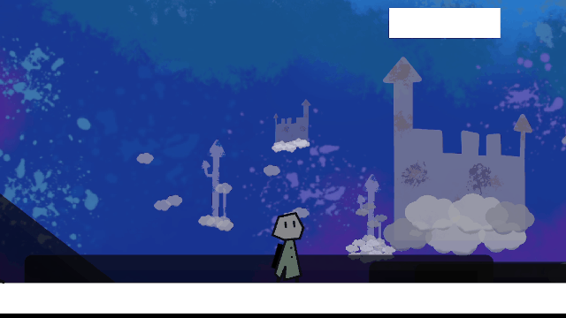
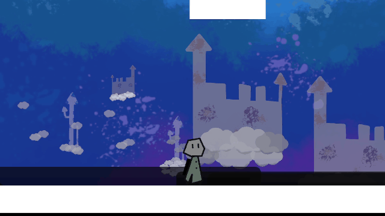
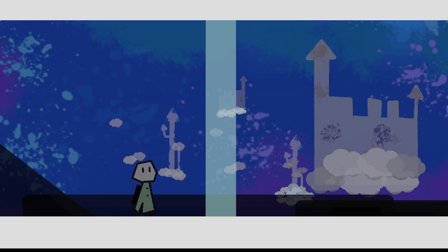
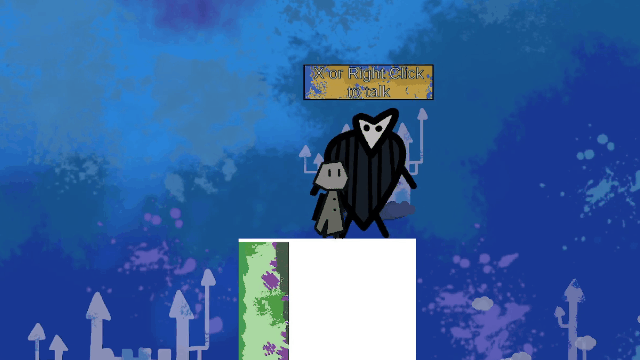
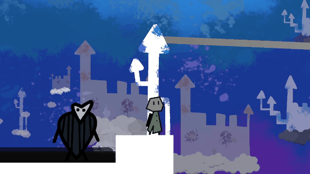

# Cokry (Oct 20, 2023)
A little 2D platformer inspired  by Rayman legends and 2D mario games.

---

##  The mechanics
### 1. Base mechanics
In this game, you can move in different ways.
* **jump**: just jump...

* **double jump**: jump two times in a row (a little higher than the normal jump.

* **triple jump**: jump three times in a row (higher than the last two).

* **backflip**: crouch and jump (same high as triple jump).

* **crouch**: just crouch...

* **slide**: crouch while walking.

* **hit**: hit a glass will break it.

### 2. Cool mechanics
* **grapple**:

* **zipline**: 

---

##  Game Structure
### 1. Levels
Each level teach you a new mechanic (hit, grapple, zipline) that will be useful in the last level (the music level). There are four levels + the music level. You can collect a special coin in each level. If you collect all the coins and complete the four levels, you will unlock the last level.

### 2. Music Level
I made a level inspired by the musical levels in Rayman Legends. In fact, you need to run through the level and your jumps are timed with the music.
[Mettre un GIF]

You can watch a video I made about it (in French):

You can play this game on [`itch.io`](https://remaf300.itch.io/cokry).
